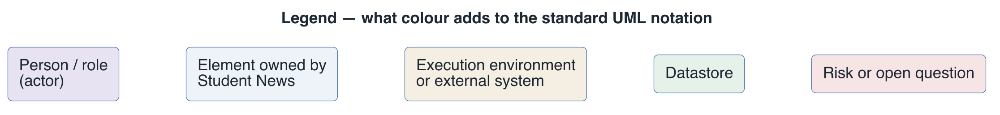

# Architecture Description — Student News

This is the roadmap of the Views-and-Beyond architecture description of Student News: what each
file covers and which one answers your question. New to the system? Read the
[system overview](system-overview.md) first, then the view your role points to below.

## How this documentation is organised

| File | V&B part | Read it to… |
|------|----------|-------------|
| [`README.md`](README.md) (this file) | Roadmap + organisation | know what exists and where to look |
| [`system-overview.md`](system-overview.md) | System overview | understand what the system does, its context, use cases, constraints and quality scenarios |
| [`view-module-decomposition.md`](view-module-decomposition.md) | Module view (decomposition) | find where a piece of code lives |
| [`view-module-layered.md`](view-module-layered.md) | Module view (layered, uses) | see the backend classes and what each may depend on |
| [`view-cnc-client-server.md`](view-cnc-client-server.md) | C&C view (client-server) | see what runs, the HTTP interface, and each significant use case step by step |
| [`view-allocation-deployment.md`](view-allocation-deployment.md) | Allocation view (deployment) | see containers, ports, users, volumes and settings |
| [`view-allocation-ci.md`](view-allocation-ci.md) | Allocation view (install: CI pipeline) | see which job builds and tests what, and what blocks a merge |
| [`mapping-between-views.md`](mapping-between-views.md) | Mapping between views | correlate a module ↔ runtime component ↔ node |
| [`rationale.md`](rationale.md) | Rationale | understand why the big decisions were made (ADR log) |
| [`directory.md`](directory.md) | Directory | look up a term, an acronym, or where an element is defined |
| [`change-log.md`](change-log.md) | — | revision history of this description |

Every diagram is UML drawn with PlantUML; each document shows the rendered image and links to its
`.puml` source in [`diagrams/`](diagrams/legend.puml). Colour adds one layer of meaning on top
of the UML notation, explained once in the shared key, [`diagrams/legend.png`](diagrams/legend.png):

## View selection — stakeholder concerns → views

| Stakeholder | Concern | View(s) |
|-------------|---------|---------|
| Course instructor | How do I explain the system end to end in a lecture? | [system overview](system-overview.md), [runtime](view-cnc-client-server.md), [deployment](view-allocation-deployment.md) |
| Student or new contributor | Where is the code for this feature, and what may it depend on? | [decomposition](view-module-decomposition.md), [layered](view-module-layered.md) |
| Tester or integrator | What happens on each request, and which errors come back? | [runtime §2.3–2.4](view-cnc-client-server.md#23-element-interfaces), [CI pipeline](view-allocation-ci.md) |
| API developer | Which operations exist, with which payloads and status codes? | [runtime §2.3](view-cnc-client-server.md#23-element-interfaces) |
| Operator (runs the stack locally or in CI) | What runs where, on which port, as which user, and where is the data? | [deployment](view-allocation-deployment.md) |
| CI maintainer | Which job checks what, and what blocks a merge? | [CI pipeline](view-allocation-ci.md) |
| Future architect or maintainer | Why is it built this way, and what are the known gaps? | [rationale](rationale.md), each view's §5 |

## Where do I look to answer…

- *"Which use cases does the system support?"* → [system overview](system-overview.md#primary-functional-requirements-use-cases).
- *"Where is the code that creates a news item?"* → [layered view §2.1](view-module-layered.md#21-elements-and-their-properties), `NewsService.create`.
- *"What does `POST /api/news` return when the title is blank?"* → [runtime view §2.3](view-cnc-client-server.md#23-element-interfaces).
- *"Can an archived item be published again?"* → [runtime view §2.4](view-cnc-client-server.md#24-element-behavior), the state machine.
- *"Which port does the UI use, and why is it not 80?"* → [deployment view §2.1](view-allocation-deployment.md#21-elements-and-their-properties).
- *"Does my data survive `docker compose down`?"* → [deployment view §2.4](view-allocation-deployment.md#24-element-behavior).
- *"Why is my pull request red?"* → [CI pipeline view §2.1](view-allocation-ci.md#21-elements-and-their-properties).
- *"Why does the browser call port 8080 directly instead of going through nginx?"* → [ADR-2](rationale.md#adr-2-the-browser-calls-the-api-directly-with-cors-open).

## Related artifacts

- Project README (how to run, test and configure): [`../../README.md`](../../README.md)
- BDD scenarios behind the use cases: [API](../../docs/api-testing-scenarios-bdd.md), [UI](../../docs/frontend-user-scenarios-bdd.md)
- CI teaching notes: [`../../docs/CI-CD-TEACHING-NOTES.md`](../../docs/CI-CD-TEACHING-NOTES.md)

No separate drivers register or ADD design exists for this system; the drivers are defined in the
[system overview](system-overview.md) and the decisions in [rationale](rationale.md).

---

**Navigation**: [architecture package](../README.md) · [system overview](system-overview.md) ·
[decomposition](view-module-decomposition.md) · [layered](view-module-layered.md) ·
[runtime](view-cnc-client-server.md) · [deployment](view-allocation-deployment.md) ·
[CI pipeline](view-allocation-ci.md)
