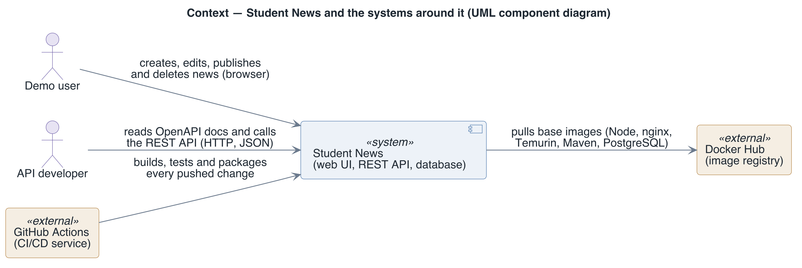
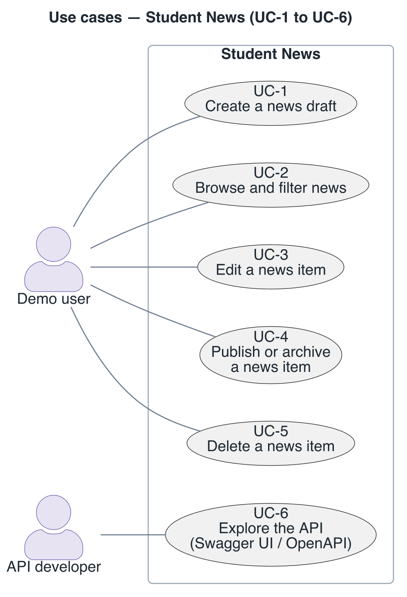

# System overview — Student News

This page says what Student News does, what surrounds it, and which drivers shaped it: one
business goal, six use cases, four constraints and five quality attribute scenarios. Read it
before any of the views; every view's rationale cites the IDs defined here.

## What it does

Student News lets a demo user create news drafts, edit them, publish or archive them, and
delete them in a browser, with no sign-in. It exists for one business goal: **BG-1**, serve as
teaching material for the Cloud & DevOps course, a small full-stack application that shows
containers, CI/CD and testing practices on real code.

## Context

The system is three containers started together with Docker Compose: a static web server for
the React single-page application, a Spring Boot REST API, and a PostgreSQL database. A demo
user works in a browser; an API developer reads the generated OpenAPI documentation. GitHub
Actions builds and tests every change, and the images are built from public base images on
Docker Hub.

Source: [`diagrams/system-overview-context.puml`](diagrams/system-overview-context.puml).
Colour key: [`diagrams/legend.png`](diagrams/legend.png).

Four constraints shape the design:

| ID | Constraint | Where it shows |
|----|------------|----------------|
| CON-1 | No authentication or authorisation; the application is a demo. | No login, no user model, CORS open to every origin |
| CON-2 | The whole stack starts with one command, `docker compose up --build`, and needs no `.env` file. | Compose defaults for every setting, health-checked start order |
| CON-3 | The stack is fixed by the course: Java 27 with Spring Boot 4, React 19 with Vite, PostgreSQL 16, Docker Compose, GitHub Actions. | Every Dockerfile, `pom.xml`, `package.json` and workflow |
| CON-4 | Every change goes through a pull request, and CI must pass before it is merged. | `ci.yml`, `e2e.yml`, the single `CI status` check |

## Primary functional requirements (use cases)

The demo user drives UC-1 to UC-5 from the web UI; an API developer drives UC-6. The scenarios
behind each use case are written out in the BDD documents
([API](../../docs/api-testing-scenarios-bdd.md), [UI](../../docs/frontend-user-scenarios-bdd.md)).

- `UC-1` Create a news draft — the item is validated and stored with status `DRAFT`.
  Architecturally significant: it is the write path with validation on both sides.
- `UC-2` Browse and filter news by status — significant: it is the read path every other use
  case ends on.
- `UC-3` Edit a news item's title and content — follows the UC-1 path through `PUT`.
- `UC-4` Publish or archive a news item — significant: it changes the item's lifecycle state.
- `UC-5` Delete a news item — follows the UC-4 path through `DELETE`.
- `UC-6` Explore the API in Swagger UI or through the OpenAPI document.

Source: [`diagrams/system-overview-use-cases.puml`](diagrams/system-overview-use-cases.puml).

## Driving quality attribute scenarios

Each scenario has the six SEI parts: a source sends a stimulus to an artifact in an
environment, and the response is judged by a measurable response measure. The ID prefix names
the quality: `DQA` deployability, `MQA` modifiability, `TQA` testability, `SQA` security,
`RQA` reliability. Measured values come from runs on 2026-11-11 (Docker Desktop on Apple
Silicon for local runs, GitHub-hosted runners for CI).

| ID | Source | Stimulus | Artifact | Environment | Response | Response measure |
|----|--------|----------|----------|-------------|----------|------------------|
| DQA-1 | Student or new contributor | Runs `docker compose up --build` on a fresh clone without a `.env` file | Whole stack (three containers) | Laptop with Docker | Images build, the database becomes healthy, API and UI start | UI answers on port 5173 and API on port 8080 within 240 s (measured: build 54 s, API start 3.2 s) |
| MQA-1 | Developer | Changes one line of backend Java and rebuilds the backend image | Backend image build | Development, warm build cache | The Maven dependency layer is reused; only compile and package run again | Rebuild in at most 30 s (measured 3 to 5 s; 76 s before the dependency layer existed) |
| TQA-1 | Contributor or Dependabot | Pushes a commit or opens a pull request to `main` | `ci.yml` and `e2e.yml` | GitHub-hosted runners | Lint, 4 unit tests, 10 integration tests, both image builds and 10 Playwright tests run and report on the pull request | All results within 5 min (measured: CI about 2 min, E2E about 1.5 min) |
| SQA-1 | Anyone who gains code execution in a container, or a reviewer auditing it | Inspects the process user and what the host exposes | frontend, backend and db containers | Normal operation on a developer machine | Application processes run unprivileged; the database is reachable from the host only through loopback; images carry no credentials | 0 root processes in frontend and backend, 0 non-loopback database listeners, 0 passwords in image config or history |
| RQA-1 | Operator | Runs `docker compose down`, then `docker compose up -d` | News data | Normal operation | Data is read back from the named volume `postgres_data` | 0 news items lost; only `docker compose down -v` deletes them |

Performance, scalability and availability are not drivers: the system runs as one instance for
demos, and nothing has been measured for them.

---

**Navigation**: [docs README](README.md) · [architecture package](../README.md)
