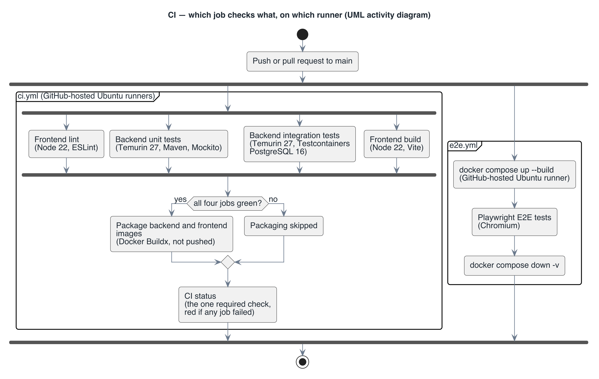

# View: CI pipeline  (Allocation / install)

- **Viewtype**: Allocation
- **Style**: install (which build, test and packaging step runs for each unit, and on which runner)
- **Stakeholders / concerns addressed**: contributors (what must pass before a merge?), CI maintainer (which job checks what?), course instructor (stage ordering, cheapest check first)
- **Date**: 2026-11-11

This view maps the code units of the [decomposition view](view-module-decomposition.md) onto
the GitHub Actions jobs that build, test and package them. Read it to find out why a pull
request is red and which job to open.

## 1. Primary presentation

Source: [`diagrams/view-allocation-ci.puml`](diagrams/view-allocation-ci.puml).
Legend: [`diagrams/legend.png`](diagrams/legend.png). Thick bars are UML fork and join: the
actions between them run in parallel. Each frame is one workflow file.

## 2. Element catalog

### 2.1 Elements and their properties

| Element | Responsibility / role | Key properties |
|---------|-----------------------|----------------|
| Frontend lint | Runs ESLint on `frontend` | Node 22, `npm ci` from the lock file; about 10 s |
| Backend unit tests | Runs `NewsServiceTest` | Temurin 27, Maven; excludes `*IntegrationTest` and `*E2ETest`; about 15 to 30 s |
| Backend integration tests | Runs `NewsApiE2ETest` against PostgreSQL 16 in a Testcontainers container | Temurin 27; uses the runner's Docker; about 30 to 45 s |
| Frontend build | Runs `vite build` on `frontend` | Node 22; uploads `dist/` as an artifact |
| Package | Builds the backend and frontend images from their Dockerfiles | Docker Buildx with the GitHub Actions cache; images are not pushed |
| CI status | Summarises the run for branch protection | Always runs; red if any job failed or was cancelled |
| E2E | Starts the Compose stack and runs 10 Playwright tests in Chromium | Separate workflow `e2e.yml`; tears the stack down with `docker compose down -v` |

### 2.2 Relations and their properties

| From | Relation | To | Properties |
|------|----------|----|-----------|
| Push or pull request to `main` | triggers | `ci.yml`, `e2e.yml` | Both workflows run in parallel; a newer push cancels an older `ci.yml` run on the same branch |
| Lint, unit, integration, build | all must pass before | Package | `needs:` in `ci.yml`; packaging is skipped otherwise |
| Every `ci.yml` job | reports to | CI status | The one check branch protection needs to require |
| `frontend` | is checked by | lint, build, package (frontend), E2E | Node 22 in the CI jobs, Node 26 inside the image build |
| `backend` | is checked by | unit, integration, package (backend), E2E | Temurin 27 in every job and in both image stages |
| `e2e` | is run by | E2E | Chromium only; one worker, so tests run in order |

### 2.3 Element interfaces

Each job reports a pass or fail status to the pull request. Evidence a reader can open after
the run: `backend-surefire-reports` and `backend-integration-surefire-reports` (JUnit XML, kept
7 days), `frontend-dist`, and `playwright-report` when the E2E run fails.

### 2.4 Element behavior

The four checks start at the same time; the slowest decides when packaging starts. On the run
measured for this description the whole `ci.yml` took 2 min 7 s (integration tests 43 s,
backend packaging 1 min 16 s) and `e2e.yml` took 1 min 22 s.

## 3. Context diagram

The scope is the two workflows that run on every change. Outside it: `deploy.yml`, a manual dry
run that deploys nothing; Dependabot, which opens pull requests that then go through this same
pipeline; and the developer's own machine, where the same commands can be run by hand.

## 4. Variability guide

- The `-Dtest` filters in `ci.yml` decide which backend tests run in which job; a new test class
  named `*IntegrationTest` or `*E2ETest` moves to the integration job automatically.
- `deploy.yml` takes a target environment (`staging` or `production`) and an optional image
  tag when started by hand.

## 5. Rationale

- Cheapest checks first and in parallel, with packaging gated on all of them, gives feedback on
  a pull request in about 2 minutes (`TQA-1`, `CON-4`);
  see [ADR-6](rationale.md#adr-6-tests-split-by-what-they-need-across-parallel-ci-jobs).
- One summary check means branch protection does not have to change when a job is added
  (`CON-4`).
- Packaging in CI catches a broken Dockerfile on the pull request, before anyone runs the
  stack (`DQA-1`).

---

**Navigation**: [docs README](README.md) · [architecture package](../README.md)
