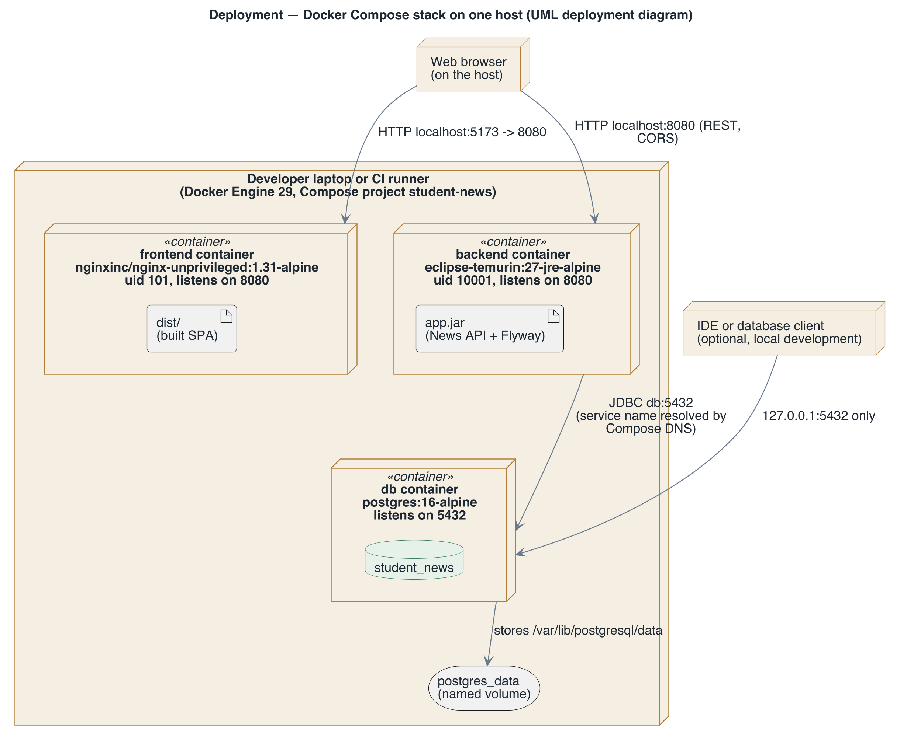

# View: Deployment  (Allocation / deployment)

- **Viewtype**: Allocation
- **Style**: deployment
- **Stakeholders / concerns addressed**: operator running the stack (what runs where, on which port, as which user, where is data kept?), course instructor (containers, volumes and Compose networking), security reviewer (`SQA-1`)
- **Date**: 2026-11-11

This view maps the runtime components onto containers and the containers onto one Docker host,
which is the same on a laptop and on a CI runner. Read it to start, reach or debug the running
stack.

## 1. Primary presentation

Source: [`diagrams/view-allocation-deployment.puml`](diagrams/view-allocation-deployment.puml).
Legend: [`diagrams/legend.png`](diagrams/legend.png). Boxes with a 3D edge are UML nodes
(execution environments); a folded-corner box is an artifact deployed on a node.

## 2. Element catalog

### 2.1 Elements and their properties

| Element | Responsibility / role | Key properties |
|---------|-----------------------|----------------|
| Docker host | Runs the Compose project `student-news` | A developer laptop with Docker Desktop, or a GitHub-hosted Ubuntu runner in `e2e.yml`; Docker Engine 29 |
| frontend container | Hosts the static web server and the built Web UI (`dist/`) | Image `nginxinc/nginx-unprivileged:1.31-alpine`, built with `node:26-alpine`; runs as uid 101; listens on 8080, published on host port 5173 |
| backend container | Hosts the News API and the schema migrator (`app.jar`) | Image `eclipse-temurin:27-jre-alpine`, built with `maven:3.10-eclipse-temurin-27`; runs as uid 10001, the jar owned by root and read-only to it; listens on 8080, published on host port 8080 |
| db container | Hosts the News database `student_news` | Image `postgres:16-alpine`; server processes run as `postgres`; listens on 5432, published on `127.0.0.1:5432` only; starts the others once `pg_isready` succeeds |
| `postgres_data` | Keeps the database files across container restarts | Named Docker volume mounted at `/var/lib/postgresql/data`; removed only by `docker compose down -v` |
| Web browser | Runs the Web UI and calls the API | On the same host; reaches both published ports through `localhost` |
| IDE or database client | Optional: a backend started from the IDE, or a SQL client | Connects to `127.0.0.1:5432`, the default in `application.properties` |

### 2.2 Relations and their properties

| From | Relation | To | Properties |
|------|----------|----|-----------|
| Web browser | HTTP, `localhost:5173` mapped to 8080 | frontend container | Page and bundle download |
| Web browser | HTTP, `localhost:8080` | backend container | REST calls; cross-origin, so CORS applies |
| backend container | JDBC, `db:5432` | db container | `db` is the Compose service name, resolved by Compose's DNS on the project network |
| db container | volume mount | `postgres_data` | Read and write; survives `docker compose down` |
| IDE or database client | TCP, `127.0.0.1:5432` | db container | Loopback only; not reachable from other machines |
| Compose | `depends_on` with `condition: service_healthy` | backend on db | The API starts only after the database answers |

### 2.3 Element interfaces

Each container exposes one port: frontend 8080, backend 8080, db 5432. Containers have separate
network namespaces, so frontend and backend can both use 8080 inside. The host sees them through
the published ports above. Settings reach the containers as environment variables, never as
files baked into an image:

| Variable | Default | Used by |
|----------|---------|---------|
| `POSTGRES_DB` | `student_news` | db (creates the database), backend (JDBC URL) |
| `POSTGRES_USER` | `student` | db, backend |
| `POSTGRES_PASSWORD` | `student` | db, backend |

### 2.4 Element behavior

Start-up order: `db` starts and passes its health check; `backend` starts, Flyway applies the
schema, and the API listens; `frontend` starts after `backend` has started. `docker compose down`
removes the three containers and the network and keeps `postgres_data`;
`docker compose down -v` removes the volume as well (`RQA-1`).

## 3. Context diagram

The view covers one Docker host. Outside it: the image registry the base images come from
(Docker Hub), and GitHub Actions, which provides the runner when `e2e.yml` starts the same
stack. No cloud deployment exists; the manual `deploy.yml` workflow is a dry run.

## 4. Variability guide

- A `.env` file next to `docker-compose.yml` overrides `POSTGRES_DB`, `POSTGRES_USER` and
  `POSTGRES_PASSWORD`; [`.env.example`](../../.env.example) documents them. Postgres reads them
  only when the volume is first created, so run `docker compose down -v` after changing them.
- The published host ports (5173, 8080, 127.0.0.1:5432) are set in `docker-compose.yml`.
- The E2E suite can run against a stack that is already up: `E2E_SKIP_DOCKER=1`, with
  `PLAYWRIGHT_BASE_URL` and the other `E2E_*` variables pointing at it.

## 5. Rationale

- One container per tier, composed on one host, gives the one-command start of `CON-2` and
  `DQA-1`; see [ADR-1](rationale.md#adr-1-one-container-per-tier-composed-with-docker-compose).
- Non-root users in both application images, credentials only in the environment, and the
  database port bound to loopback meet `SQA-1`;
  see [ADR-5](rationale.md#adr-5-small-non-root-images-with-a-cached-dependency-layer).
- The named volume separates data from the disposable database container (`RQA-1`).
- Open risk: the frontend image builds with Node 26 while the CI lint and build jobs use
  Node 22, so CI does not test the exact toolchain that builds the image (`TQA-1`).

---

**Navigation**: [docs README](README.md) · [architecture package](../README.md)
