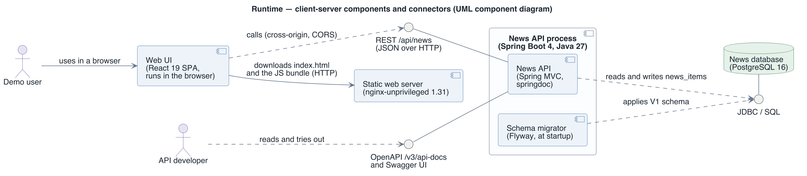
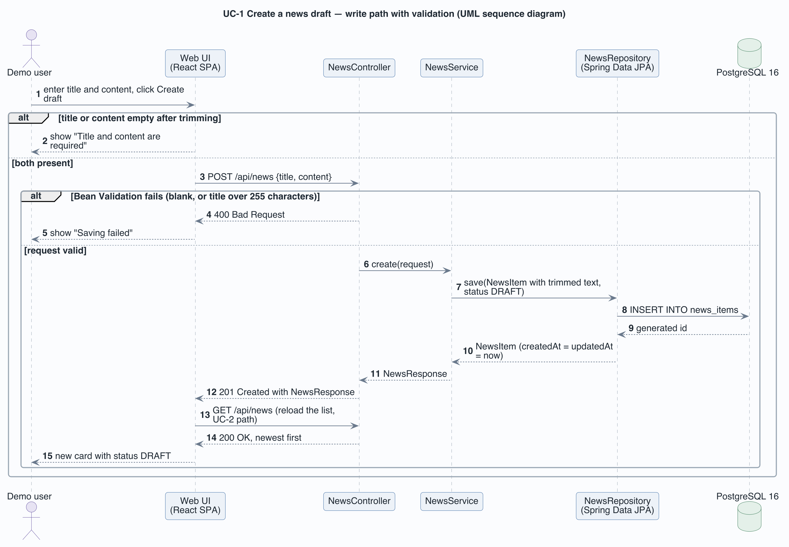
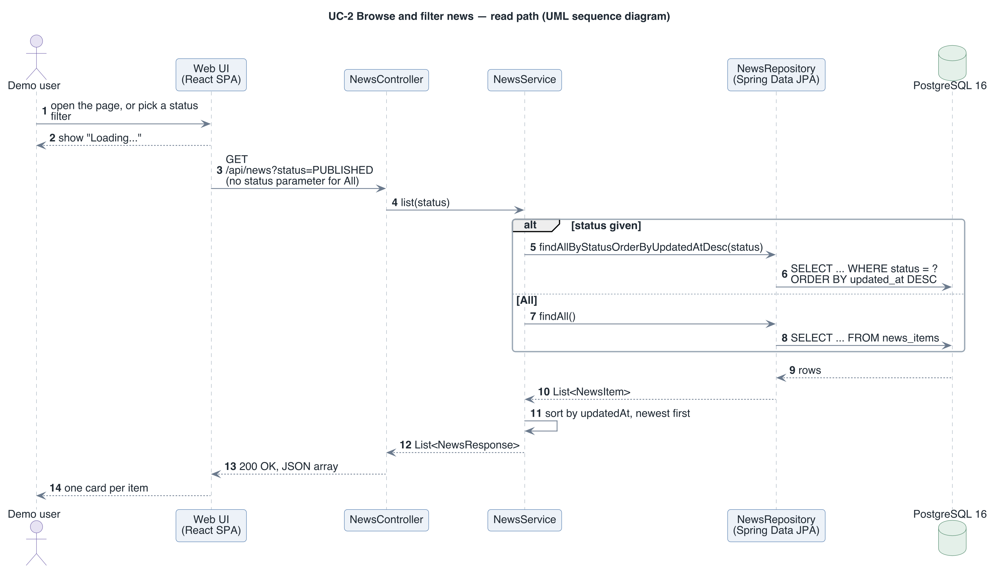
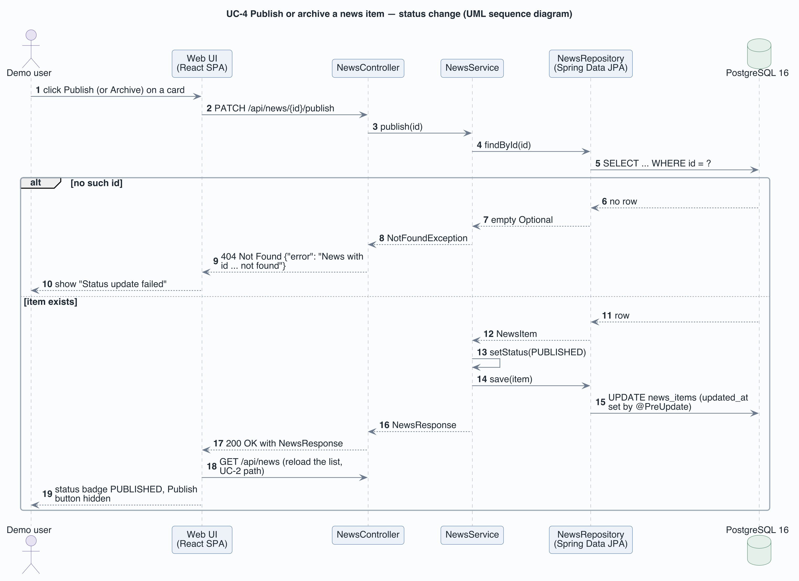
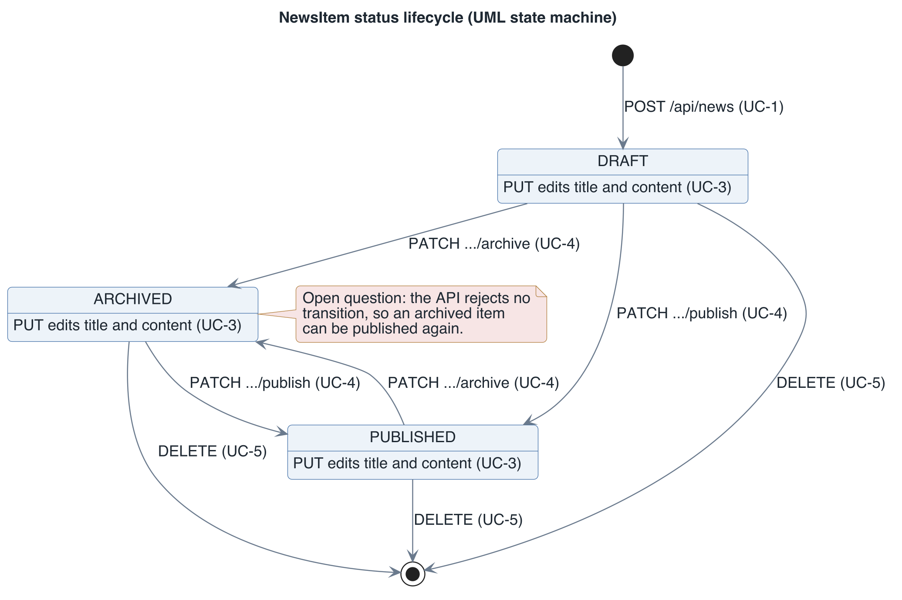

# View: Runtime  (Component-and-Connector / client-server)

- **Viewtype**: Component-and-Connector
- **Style**: client-server (a browser client, a stateless REST server, a shared database)
- **Stakeholders / concerns addressed**: course instructor (what runs and how the parts talk), testers and integrators (what happens on each request, which errors come back), API developers (the HTTP interface), future architect (where the security and lifecycle gaps are)
- **Date**: 2026-11-11

This view shows what runs when the system is used and how the parts interact: five runtime
components joined by HTTP and JDBC connectors. §2.3 is the HTTP interface reference; §2.4
walks through the three significant use cases step by step.

## 1. Primary presentation

Source: [`diagrams/view-cnc-client-server.puml`](diagrams/view-cnc-client-server.puml).
Legend: [`diagrams/legend.png`](diagrams/legend.png). A circle on a line is a provided
interface (UML lollipop); a dashed arrow to it means the client requires that interface.

## 2. Element catalog

### 2.1 Elements and their properties

| Element | Responsibility / role | Key properties |
|---------|-----------------------|----------------|
| Web UI | Form, status filter and news list; runs entirely in the user's browser | React 19 single-page application; keeps no state across reloads; API base URL fixed at build time |
| Static web server | Serves `index.html`, the JavaScript bundle and the CSS | nginx 1.31 with its default configuration; no proxying, no API knowledge |
| News API | Implements UC-1 to UC-6 over HTTP; publishes the OpenAPI document and Swagger UI | Spring Boot 4 on Java 27; stateless, so any number of instances could serve the same database; the only writer to the database |
| Schema migrator | Brings the database schema to the latest Flyway version | Runs inside the News API process at startup, before the API accepts requests; Hibernate then only validates the schema |
| News database | Stores every news item | PostgreSQL 16, one table `news_items`; the system of record |

### 2.2 Relations and their properties

| From | Relation | To | Properties |
|------|----------|----|-----------|
| Web UI | HTTP GET | Static web server | Downloads the application once per page load |
| Web UI | REST over HTTP, JSON | News API | Cross-origin (port 5173 to port 8080); allowed by a CORS policy open to every origin |
| API developer's browser | HTTP | News API (OpenAPI, Swagger UI) | Read-only documentation, generated from the code |
| News API | JDBC / SQL | News database | Connection settings from `SPRING_DATASOURCE_*`; one transaction per repository call |
| Schema migrator | JDBC / SQL | News database | Applies pending scripts and records them in `flyway_schema_history` |

### 2.3 Element interfaces

The News API's REST interface, `/api/news`. Interaction style: synchronous request and
response over HTTP. Data: JSON; an item is `{id, title, content, status, createdAt,
updatedAt}` with ISO-8601 UTC timestamps. Scope: no authentication (`CON-1`).

| Operation | Request | Success | Errors |
|-----------|---------|---------|--------|
| List news (UC-2) | `GET /api/news`, optional `?status=DRAFT\|PUBLISHED\|ARCHIVED` | `200` with an array, newest `updatedAt` first | `400` for an unknown status value |
| Create a draft (UC-1) | `POST /api/news` with `{title, content}` | `201` with the item, status `DRAFT` | `400` if `title` or `content` is blank or `title` exceeds 255 characters |
| Edit (UC-3) | `PUT /api/news/{id}` with `{title, content}` | `200` with the item | `400` as above; `404` if the id is unknown |
| Publish (UC-4) | `PATCH /api/news/{id}/publish` | `200` with the item, status `PUBLISHED` | `404` if the id is unknown |
| Archive (UC-4) | `PATCH /api/news/{id}/archive` | `200` with the item, status `ARCHIVED` | `404` if the id is unknown |
| Delete (UC-5) | `DELETE /api/news/{id}` | `204`, no body | `404` if the id is unknown |
| API documentation (UC-6) | `GET /v3/api-docs`, `GET /swagger-ui/index.html` | `200` with the OpenAPI document or the UI | — |

Error model: a `404` carries `{"error": "News with id N not found"}`; a `400` carries Spring
Boot's default error body. The Web UI shows its own short message ("Saving failed", "Status
update failed", "Delete failed") and does not display the server's text.

### 2.4 Element behavior

One sequence diagram per architecturally significant use case (UC-1, UC-2, UC-4), then the
state machine every news item follows.

Source: [`diagrams/view-cnc-client-server-uc1.puml`](diagrams/view-cnc-client-server-uc1.puml).

UC-1 is validated twice. The Web UI refuses to send a request when the trimmed title or
content is empty; the API rejects blank fields and titles over 255 characters with a `400`
before any business code runs. A valid request is trimmed again, saved as `DRAFT`, and the
Web UI then reloads the whole list rather than inserting the new card itself. UC-3 (edit)
takes the same path through `PUT`.

Source: [`diagrams/view-cnc-client-server-uc2.puml`](diagrams/view-cnc-client-server-uc2.puml).

UC-2 has two database queries. With a status filter the repository asks PostgreSQL for the
matching rows already ordered by `updated_at`; for All it loads every row. In both cases the
service sorts the result again, newest first, so the order does not depend on the query.
Every other use case ends by running this path to refresh the list.

Source: [`diagrams/view-cnc-client-server-uc4.puml`](diagrams/view-cnc-client-server-uc4.puml).

UC-4 loads the item, changes its status and saves it; `@PreUpdate` refreshes `updatedAt`, so
the item moves to the top of the list. An unknown id ends in a `404` with an error body.
Archive works the same way with `.../archive`, and UC-5 (delete) follows the same lookup with
`DELETE` and a `204`.

Source: [`diagrams/view-cnc-client-server-state.puml`](diagrams/view-cnc-client-server-state.puml).

Every item starts as `DRAFT` (UC-1) and can be edited in any state (UC-3). The API accepts
every publish and archive request (UC-4), including publishing an archived item again; only
the Web UI hides the button for the state the item is already in. Delete (UC-5) ends the
lifecycle from any state. Whether archived items may come back is an open product question,
marked in red on the diagram.

## 3. Context diagram

Outside this view: the user's browser itself, Docker Compose, which starts the components, and
GitHub Actions, which tests them. Where each component runs is in the
[deployment view](view-allocation-deployment.md); the system-level context is in the
[system overview](system-overview.md#context).

## 4. Variability guide

- `VITE_API_URL`, set when the frontend is built, changes the API base URL the Web UI calls
  (default `http://localhost:8080/api/news`). A different URL needs a rebuilt frontend image.
- `SPRING_DATASOURCE_URL`, `SPRING_DATASOURCE_USERNAME` and `SPRING_DATASOURCE_PASSWORD` point
  the News API at another PostgreSQL database; Compose sets them from the `POSTGRES_*` values.
- The `status` query parameter selects one of the two UC-2 query paths.

## 5. Rationale

- The browser calls the News API directly instead of through nginx, which keeps the static
  server on its default configuration and the stack at one command (`CON-2`, `DQA-1`). The
  cost is an open CORS policy, acceptable only because there is no authentication (`CON-1`);
  see [ADR-2](rationale.md#adr-2-the-browser-calls-the-api-directly-with-cors-open).
- A stateless News API with the database as the only shared state means the API container can
  be replaced or restarted without losing data (`RQA-1`).
- Running Flyway inside the API process guarantees the schema is current before the first
  request, in Compose and in the Testcontainers tests alike (`TQA-1`,
  [ADR-3](rationale.md#adr-3-flyway-owns-the-schema-hibernate-only-validates-it)).

---

**Navigation**: [docs README](README.md) · [architecture package](../README.md)
