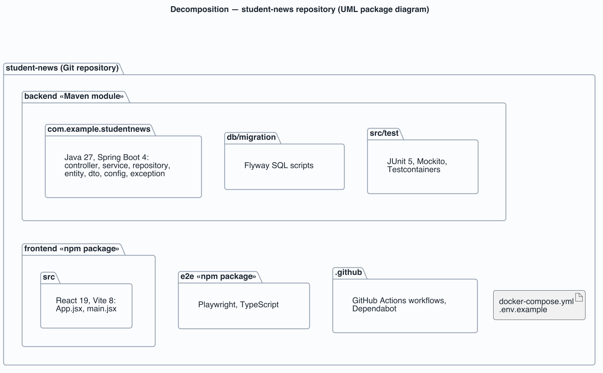

# View: Decomposition  (Module / decomposition)

- **Viewtype**: Module
- **Style**: decomposition
- **Stakeholders / concerns addressed**: students and new contributors (where is the code for X?), course instructor (how is the repository organised?), CI maintainer (which unit does each job build?)
- **Date**: 2026-11-11

This view shows how the repository is divided into implementation units and what each unit
contains. Start here to find where a piece of code lives; the
[layered view](view-module-layered.md) then shows the classes inside the backend.

## 1. Primary presentation

Source: [`diagrams/view-module-decomposition.puml`](diagrams/view-module-decomposition.puml).
Legend: [`diagrams/legend.png`](diagrams/legend.png). Nesting means *is part of*; the view has
no other relation.

## 2. Element catalog

### 2.1 Elements and their properties

| Element | Responsibility / role | Key properties |
|---------|-----------------------|----------------|
| `backend` | Maven module that builds the News API jar | Java release 27, Spring Boot 4.1 parent POM; one jar, `student-news-0.0.1-SNAPSHOT.jar` |
| `com.example.studentnews` | API source code in seven packages: `controller`, `service`, `repository`, `entity`, `dto`, `config`, `exception` | 10 types plus the `StudentNewsApplication` entry point in the root package; detail in the [layered view](view-module-layered.md) |
| `db/migration` | Database schema as versioned Flyway scripts | One script, `V1__create_news_items.sql`: table `news_items` with indexes on `status` and `updated_at` |
| `src/test` | Backend tests | `NewsServiceTest` (4 unit tests, Mockito, no database); `NewsApiE2ETest` (10 HTTP-to-database tests, Testcontainers PostgreSQL 16) |
| `frontend` | npm package that builds the web UI | React 19, Vite 8, ESLint 10; output is static files in `dist/` |
| `frontend/src` | The whole UI: one `App` component plus the entry point | `App.jsx` holds the form, the status filter and the list; the API base URL comes from `VITE_API_URL` at build time |
| `e2e` | Browser tests against the running stack | Playwright with Chromium, 10 tests; global setup starts and stops Docker Compose |
| `.github` | Pipeline and dependency automation | Workflows `ci.yml`, `e2e.yml`, `deploy.yml` (manual dry run); Dependabot for Maven, npm, Actions, Docker and Compose |
| `docker-compose.yml`, `.env.example` | Composition of the three containers and their settings | Defaults for every variable, so no `.env` file is needed |

### 2.2 Relations and their properties

| From | Relation | To | Properties |
|------|----------|----|-----------|
| `com.example.studentnews`, `db/migration`, `src/test` | is part of | `backend` | One Maven build; tests run in `mvn test` |
| `frontend/src` | is part of | `frontend` | One npm build |
| `backend`, `frontend`, `e2e`, `.github`, `docker-compose.yml` | is part of | repository root | Each top-level directory has its own build file or is pure configuration |

### 2.3 Element interfaces

The units meet at runtime interfaces, not at compile time: the frontend calls the backend only
over HTTP, and `e2e` drives the frontend only through a browser. No unit imports code from
another. The HTTP interface is catalogued in the
[runtime view §2.3](view-cnc-client-server.md#23-element-interfaces).

### 2.4 Element behavior

None at this level — a decomposition has no runtime behaviour. See the
[runtime view §2.4](view-cnc-client-server.md#24-element-behavior).

## 3. Context diagram

The scope is the Git repository `rtym/student-news`. Outside it: the base images pulled from
Docker Hub, the Maven Central and npm registries the builds download from, and GitHub Actions,
which runs the workflows in `.github`. See the context diagram in the
[system overview](system-overview.md#context).

## 4. Variability guide

None. The repository has no build profiles, plug-in points or feature flags; configuration
happens at runtime and is covered in the [deployment view](view-allocation-deployment.md#4-variability-guide).

## 5. Rationale

- One directory per deployable unit (`backend`, `frontend`) plus one for the browser tests
  keeps each build independent, so CI can lint, build and test them in parallel jobs (`TQA-1`)
  and each Dockerfile copies only its own directory (`MQA-1`).
- Schema scripts live inside the backend module so the same migrations run in the container,
  in the Testcontainers tests and on a developer database (`TQA-1`, [ADR-3](rationale.md#adr-3-flyway-owns-the-schema-hibernate-only-validates-it)).
- Everything needed to run the stack is in the repository root, `docker-compose.yml` and
  `.env.example`, which is what makes one-command start possible (`CON-2`, `DQA-1`).

---

**Navigation**: [docs README](README.md) · [architecture package](../README.md)
