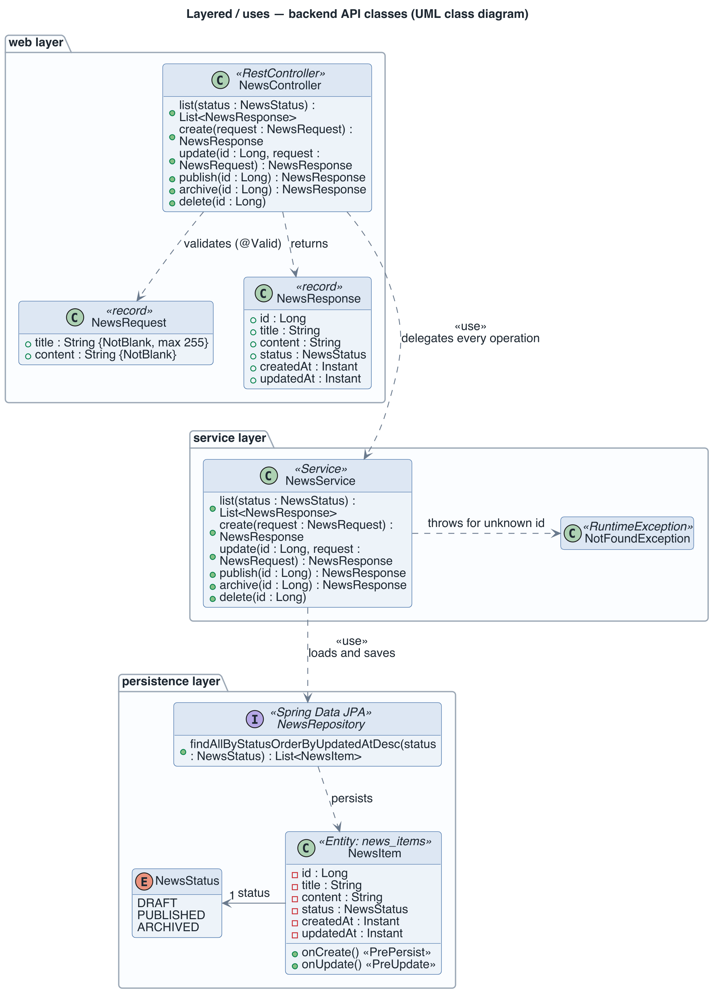

# View: Layered backend  (Module / layered and uses)

- **Viewtype**: Module
- **Style**: layered (with the uses relation between classes)
- **Stakeholders / concerns addressed**: students and new contributors (which class does what, and what may it call?), testers (where are the seams for unit tests?), future architect (impact of a change)
- **Date**: 2026-11-11

This view shows the backend's classes in three layers and which classes use which. Read it
before changing backend code: a class may use classes in its own layer or the layer directly
below it, never one above.

## 1. Primary presentation

Source: [`diagrams/view-module-layered.puml`](diagrams/view-module-layered.puml).
Legend: [`diagrams/legend.png`](diagrams/legend.png). Dashed arrows are UML dependencies
(*uses*); the solid arrow is an association.

## 2. Element catalog

### 2.1 Elements and their properties

| Element | Responsibility / role | Key properties |
|---------|-----------------------|----------------|
| `NewsController` (web layer) | Maps the six HTTP operations under `/api/news` to service calls; turns `NotFoundException` into a 404 | Bean Validation on request bodies (`@Valid`); OpenAPI annotations feed Swagger UI |
| `NewsRequest` (web layer) | Body of create and update requests | Java record; `title` not blank and at most 255 characters, `content` not blank |
| `NewsResponse` (web layer) | Body of every response that returns an item | Java record; never exposes the entity itself |
| `NewsService` (service layer) | Business rules: trims input, sets the status, sorts lists newest first, raises `NotFoundException` | Stateless Spring bean; unit-tested with a mocked repository |
| `NotFoundException` (service layer) | Signals an unknown id | Unchecked; message `News with id N not found` |
| `NewsRepository` (persistence layer) | Loads and saves `NewsItem` rows | Spring Data JPA interface; adds one derived query, `findAllByStatusOrderByUpdatedAtDesc` |
| `NewsItem` (persistence layer) | Entity mapped to table `news_items` | Sets `createdAt` and `updatedAt` in `@PrePersist`, refreshes `updatedAt` in `@PreUpdate`; status defaults to `DRAFT` |
| `NewsStatus` (persistence layer) | The three lifecycle states | `DRAFT`, `PUBLISHED`, `ARCHIVED`; stored as a string |

Three classes sit outside the layers and are left out of the diagram: `StudentNewsApplication`
(the Spring Boot entry point), `CorsConfig` (allows every origin on `/api/**`) and
`OpenApiConfig` (title and version of the generated API document).

### 2.2 Relations and their properties

| From | Relation | To | Properties |
|------|----------|----|-----------|
| `NewsController` | uses | `NewsService` | Every operation is delegated; the controller holds no logic |
| `NewsController` | uses | `NewsRequest`, `NewsResponse` | Request validated before the service is called |
| `NewsService` | uses | `NewsRepository` | One repository call per read, one load and one save per write |
| `NewsService` | throws | `NotFoundException` | For update, publish, archive and delete of an unknown id |
| `NewsRepository` | persists | `NewsItem` | Through Hibernate; schema owned by Flyway |
| `NewsItem` | association, multiplicity 1 | `NewsStatus` | Each item has exactly one status |

### 2.3 Element interfaces

`NewsService` is the interface the web layer depends on: `list(status)`, `create(request)`,
`update(id, request)`, `publish(id)`, `archive(id)` and `delete(id)`. Each returns
`NewsResponse` objects (or nothing for `delete`) and reports an unknown id with
`NotFoundException`. The HTTP form of the same operations is in the
[runtime view §2.3](view-cnc-client-server.md#23-element-interfaces).

### 2.4 Element behavior

The order of calls through the layers for UC-1, UC-2 and UC-4, and the status lifecycle, are in
the [runtime view §2.4](view-cnc-client-server.md#24-element-behavior).

## 3. Context diagram

The scope is the Java package `com.example.studentnews` inside the
[`backend` module](view-module-decomposition.md). Below the persistence layer sit Spring Data
JPA, Hibernate and the PostgreSQL JDBC driver; above the web layer sits Spring MVC. Neither is
part of this view.

## 4. Variability guide

None. The layers have no plug-in points; the only runtime choice, the optional `status`
filter, is a request parameter handled inside `NewsService.list`.

## 5. Rationale

- Three layers with downward-only dependencies let `NewsServiceTest` replace the repository
  with a Mockito mock and run without a database in milliseconds, so the unit-test job stays
  the fastest backend check (`TQA-1`, [ADR-4](rationale.md#adr-4-three-backend-layers-with-records-at-the-http-boundary)).
- Records at the HTTP boundary decouple the JSON shape from the table: a column can change in
  a migration without changing the API, and the reverse (`MQA-1`).
- Bean Validation on `NewsRequest` rejects blank fields before any business code runs, which
  backs the UI's own check in UC-1 (`UC-1`).

---

**Navigation**: [docs README](README.md) · [architecture package](../README.md)
